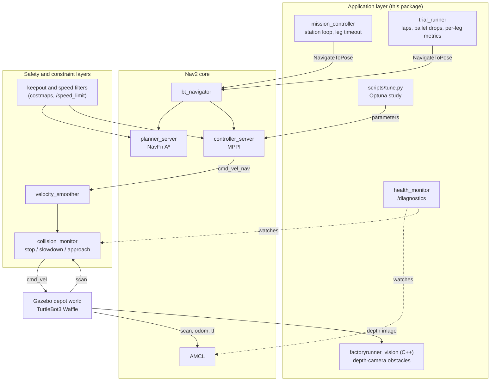

# FactoryRunner

A TurtleBot3 Waffle runs a four-station loop in Gazebo's depot world under Nav2: RAW_MATERIAL → CNC_CELL → INSPECTION → DOCK. A forklift lane is a keepout zone, the CNC cell is a 40 % speed zone, and the collision monitor has stop and slowdown fields. A mission controller and a trial harness sit on top of Nav2; all navigation comes from Nav2 plugins and configuration. Around it are the tools used to test it: pallet drops at controlled distances and a pallet that crosses the aisle, a health monitor, a C++ depth-camera detector for obstacles the LiDAR cannot see, and an Optuna study of four Nav2 parameters checked on held-out laps. The robot itself is the stock model, unmodified.

**Video:** _link to be added_


## Highlights

- **Navigation that holds up under test:** 40/40 legs in a 10-lap trial with a pallet dropped into the path, and a sweep showing exactly where the safety layer takes over as warning time shrinks (3.0 m down to 1.2 m).
- **Two real faults diagnosed from evidence:** a Nav2 freeze traced with gdb thread dumps to Fast DDS locks (fixed by switching middleware), and a 20 ms behaviour-tree timeout that let one late reply abort whole goals. The full story is in [docs/CHALLENGES.md](docs/CHALLENGES.md).
- **Perception without touching the robot:** the stock Waffle's own depth camera, unused by Nav2's launch, feeds a C++/OpenCV detector that sees a 10 cm crate the LiDAR misses.
- **Machine learning where the data is:** an Optuna study of four Nav2 parameters; on a pallet position it never saw, the tuned set beat the defaults in 99 of 100 lap pairings (10 + 10 laps, p = 2.2 × 10⁻⁵), 3.8 % faster with no added failures.
- **Reliability tooling:** a health monitor on `/diagnostics`, per-leg timeouts, a trial harness with static, timed and moving obstacles, local CI (`scripts/check.sh`) and a headless Docker image.

## Quick start

On Ubuntu 24.04 (native or WSL2):

```bash
mkdir -p ~/fr_ws/src && cd ~/fr_ws/src
git clone https://github.com/not-good-keeper/factoryrunner-nav2.git
bash factoryrunner-nav2/scripts/setup_jazzy.sh        # ROS 2 Jazzy, Nav2, Gazebo, Cyclone DDS
cd ~/fr_ws && source /opt/ros/jazzy/setup.bash
colcon build --symlink-install --base-paths src src/factoryrunner-nav2/factoryrunner_vision
source install/setup.bash && export RMW_IMPLEMENTATION=rmw_cyclonedds_cpp
ros2 launch factoryrunner sim.launch.py               # terminal 1: Gazebo + RViz + Nav2
ros2 run factoryrunner mission_controller             # terminal 2 (same sourcing): one station loop
```

Details, options and every other program are under [Setup](#setup) and [Run](#run).

## Tested with

| | Version |
|---|---|
| OS | Ubuntu 24.04.5 LTS (WSL2 on Windows 11, RTX 3060) |
| ROS 2 | Jazzy; `ros-jazzy-navigation2` 1.3.13 |
| Simulator | Gazebo Harmonic (gz sim 8.15.0), `ros-jazzy-ros-gz-sim` 1.0.24 |
| Robot and world | `nav2_minimal_tb3_sim` 1.0.1 (default `turtlebot3_waffle`), depot world from `nav2_minimal_tb4_sim` 1.0.1 |
| Middleware | Cyclone DDS (`rmw_cyclonedds_cpp` 2.2.4) |
| Tuner | Optuna 5.0.0 in a venv |
| Vision | C++17, OpenCV 4.6, `cv_bridge` 4.1 |

## How it fits together



1. **Nav2 core.** AMCL localizes against Nav2's depot map. NavFn plans with A*, and MPPI follows the path. The behaviour tree is Jazzy's default replanning-and-recovery tree.
2. **Safety and constraint layers.** Costmap filters read two masks generated from the depot map by `scripts/make_masks.py`. The keepout mask marks a forklift lane (map x 2.0–2.8 m, y −2.5 to 2.5 m) as lethal. The speed mask sets a 40 % limit around the CNC cell, which the speed filter publishes on `/speed_limit` and MPPI applies. The collision monitor sits between the velocity smoother and the robot, with a stop box, a slowdown box (30 %) and Jazzy's footprint-approach check.
3. **Application layer.**
   - `mission_controller` sends the stations from `config/mission.yaml` one at a time, cancels any leg that takes longer than `leg_timeout_s` (default 120 sim seconds), and logs each leg to `results/missions.csv`.
   - `trial_runner` drives N laps, drops a pallet onto the CNC_CELL leg on chosen laps, and logs per-leg metrics.
   - `obstacle` spawns and removes the pallet.
   - `scripts/tune.py` is the parameter study described below.
   - `health_monitor` and the C++ `factoryrunner_vision` detector watch the stack and the robot's depth camera; they report, and never command motion.

## Setup

On a fresh Ubuntu 24.04 machine:

```bash
mkdir -p ~/fr_ws/src && cd ~/fr_ws/src
git clone https://github.com/not-good-keeper/factoryrunner-nav2.git
bash factoryrunner-nav2/scripts/setup_jazzy.sh
```

The script installs ROS 2 Jazzy, Nav2, the TB3/TB4 simulation packages and Cyclone DDS, adds `source /opt/ros/jazzy/setup.bash` and `export RMW_IMPLEMENTATION=rmw_cyclonedds_cpp` to `~/.bashrc`, and creates `~/fr_venv` with Optuna. Then build:

```bash
cd ~/fr_ws
source /opt/ros/jazzy/setup.bash
colcon build --symlink-install --base-paths src src/factoryrunner-nav2/factoryrunner_vision
source install/setup.bash
```

`factoryrunner_vision` (C++) sits inside the Python package's folder, where colcon stops searching, so it is named as a second base path.

**Docker, headless only.** The image builds the same two packages on `ros:jazzy-ros-base` and runs one program against a headless sim, writing results to the mounted folder:

```bash
docker build -t factoryrunner .
docker run --rm -v "$PWD/results:/ws/src/factoryrunner-nav2/results" factoryrunner
docker run --rm -v "$PWD/results:/ws/src/factoryrunner-nav2/results" factoryrunner trial_runner
```

Checked on the development machine (`results/docker/missions.csv`): the image is 5.64 GB, and one containerised mission completed 4/4 in 92.5 s of sim time; the container exited by itself 204 s after starting, including Gazebo's first-launch model download. No GPU is passed into the container, so Gazebo's sensor rendering presumably falls back to the CPU; I did not check its renderer there.

The first launch downloads the depot model from Gazebo Fuel, so it needs internet once.

## Run

Every terminal needs ROS, the workspace and Cyclone DDS:

```bash
source /opt/ros/jazzy/setup.bash && source ~/fr_ws/install/setup.bash && export RMW_IMPLEMENTATION=rmw_cyclonedds_cpp
```

```bash
# terminal 1: Gazebo, RViz and Nav2 in the depot world
ros2 launch factoryrunner sim.launch.py

# terminal 2, within about a minute of Nav2 coming up: one pass of the station loop
ros2 run factoryrunner mission_controller

# or the 10-lap trial with the pallet on laps 3, 6 and 9 (about 16 minutes)
ros2 run factoryrunner trial_runner

# drop the pallet anywhere by hand (map-frame metres), and take it away again
ros2 run factoryrunner obstacle spawn --x 7.71 --y -0.60
ros2 run factoryrunner obstacle remove

# stack health on /diagnostics, logged on every change
ros2 run factoryrunner health_monitor

# depth-camera obstacle detector (bridges the Waffle's own depth camera)
ros2 launch factoryrunner vision.launch.py

# one lap with the pallet dropped 1.5 m ahead, for recording
ros2 run factoryrunner trial_runner --ros-args -p mission_file:=$(ros2 pkg prefix --share factoryrunner)/config/video.yaml

# a pallet that crosses the aisle in front of the robot, 3 laps
ros2 run factoryrunner trial_runner --ros-args -p mission_file:=$(ros2 pkg prefix --share factoryrunner)/config/crossing.yaml

# the obstacle-distance sweep: 3 laps each at 3.0, 2.0, 1.5 and 1.2 m
bash ~/fr_ws/src/factoryrunner-nav2/scripts/obstacle_sweep.sh 3 3.0 2.0 1.5 1.2
```

Add `headless:=True use_rviz:=False` to the launch for runs without windows. Results go to `results/` in this checkout. Navigation only activates once the controller has set the initial pose, so start it within about a minute of launching, or the planner's activation times out.

Checks (lint, build and unit tests as in `.github/workflows/ci.yml`, run against the files git would commit; GitHub Actions does not run on this account):

```bash
bash scripts/check.sh
```

## Configuration changes from Jazzy's defaults

`config/nav2_params.yaml` starts as a copy of `nav2_bringup/params/nav2_params.yaml`. These are the only changes:

| Change | Reason |
|---|---|
| `planner_server.GridBased.use_astar: true` | A* instead of Dijkstra in NavFn; a one-line switch. No speed claim, because I did not compare them. |
| Keepout filter in both costmaps, placed before `inflation_layer` | Marks the forklift lane lethal. Before inflation, so the lane gets the same 0.7 m inflation band as walls; after it, paths hugged the lane's corner and MPPI got stuck there (see challenges). |
| Speed filter in the global costmap, publishing `/speed_limit` | 40 % speed limit in the CNC cell, applied by MPPI. |
| Collision monitor `StopZone` and `SlowdownZone` polygons | LiDAR safety fields in front of the robot; the slowdown field cuts speed to 30 %. |
| `bt_navigator.default_server_timeout: 200` (default 20 ms) | A planner acknowledgement later than 20 ms failed the replanning step without an error code, so the default tree skipped its recoveries and aborted the goal. |
| Cyclone DDS instead of Fast DDS (environment, not the params file) | The Nav2 container froze in 2 of 3 runs under Fast DDS 2.14.7 on this machine and in none of the later runs under Cyclone. |

## Results

All numbers come from files in `results/`. Runs are headless on the machine above, and times are simulation seconds.

**10-lap trial** (`results/trials_20261026-194747.csv`). The pallet (0.5 m cube) was dropped halfway along the RAW_MATERIAL → CNC_CELL leg once the robot came within 3 m of the spot, on laps 3, 6 and 9. The drop happened when the robot was 2.68–2.86 m away.

| | Laps | Lap time (s) | CNC_CELL leg (s) | Closest scan return on the CNC_CELL leg (m) |
|---|---|---|---|---|
| No pallet | 7 | 88.9–91.4, median 89.7 | 28.6–29.9 | 0.89–0.96 |
| Pallet | 3 | 91.1, 91.2, 92.3 | 30.0–31.1 | 0.78–0.81 |

All 40 legs succeeded, with no recoveries, and the collision monitor never left its normal state. With 3 m of warning the planner routes around the pallet before the slowdown field (0.70 m ahead) can reach it, so the pallet laps came in 1.4, 1.5 and 2.6 s above the median lap without it, and only the slowest of them is outside the no-pallet range, by 0.9 s. The sweep below shows what happens with less warning.

**Obstacle-distance sweep** (`results/obstacle_sweep_20261026-213234/` with 3 laps per distance and `results/obstacle_sweep_20261027-200023/` with 2 more, `scripts/obstacle_sweep.sh`). The same pallet at the same spot, dropped at four configured distances, five laps each:


| Configured drop | CNC_CELL leg (s) | Closest scan return (m) | Slowdown + stop (s) | Legs succeeded |
|---|---|---|---|---|
| 3.0 m | 29.7–31.2 | 0.76–0.81 | 0 | 5/5 |
| 2.0 m | 31.9–37.5 | 0.68–0.78 | 0–3.3 | 5/5 |
| 1.5 m | 41.7–53.9 | 0.45–0.64 | 8.1–17.1 | 5/5 |
| 1.2 m | 47.1–57.4, and one canceled at 120 s | 0.38–0.58, and 0.32 | 12.1–19.5, and 108.6 | 4/5 |

With 3 m of warning the planner reroutes before the safety fields are involved. From 2 m down, the slowdown field takes a growing share of the leg, and the robot passes closer to the pallet. At 1.2 m one lap in five ended with the pallet inside the stop field: the collision monitor then blocks every command, including the backing-up that would free the robot, so it stayed stopped until the 120 s leg timeout canceled the leg (details in the challenges). The pallet appears 0.02–0.35 m closer than configured (logged trigger distances: 2.66–2.98 m, 1.66–1.87 m, 1.15–1.44 m and 0.91–1.17 m), because the trigger uses AMCL's pose, which is only republished after 0.25 m of travel.

`config/video.yaml` uses the 1.5 m setting: all five sweep laps at that setting succeeded with 8–17 s of visible slowdown. One separate video-mode lap (`results/video_mode/`) triggered at 1.40 m and passed 0.73 m from the pallet without slowing, so a recording may need a second take.

**Moving obstacle** (`results/crossing/trials_20261026-215920.csv`, `config/crossing.yaml`). The pallet spawns at the shelf edge beside the CNC_CELL path once the robot is 3 m away, then slides across the path to the open side of the aisle at 0.25 m/s, like a cart crossing in front of the robot. It is a static model moved in 0.0125 m steps at 20 Hz through Gazebo's `set_pose` service (`factoryrunner/crossing.py`); a check with the robot parked showed its LiDAR return moving from −15° to +17° bearing as it slid 1.2 m.

| Lap | CNC_CELL leg (s) | Path (m) | Recoveries | Closest scan return (m) | Slowdown (s) |
|---|---|---|---|---|---|
| 1 | 59.3 | 13.75 | 1 | 0.25 | 13.8 |
| 2 | 40.2 | 11.69 | 0 | 0.37 | 0.3 |
| 3 | 65.0 | 12.60 | 5 | 0.23 | 20.0 |

All 12 legs succeeded, but the crossing pallet is the hardest case measured here: the leg took 40–65 s against about 30 s with no obstacle, its path was 11.7–13.8 m against 9.7–10.0 m without an obstacle in the 10-lap trial, and it came within 0.23–0.37 m. Nav2's costmaps treat each scan as static obstacles, so a moving one is chased by replanning rather than predicted. The first attempt at this run (`results/crossing/trials_20261026-212629.csv`) stopped after one leg because of a bug in the mover, not in navigation; see the challenges.

**Speed zone** (`results/speed_profile_trials_10lap_20261027b.csv`, exported from the trial's rosbag). The robot entered the CNC zone 10 times and spent about 224 s in it. Commanded speed on `/cmd_vel` had a median and 95th percentile of 0.200 m/s inside the zone (40 % of MPPI's 0.5 m/s), against 0.472 and 0.493 m/s outside. 34 of 4,748 samples inside the zone were above 0.21 m/s, all within 0.14 s of entering it, while the velocity smoother brakes at its 2.5 m/s² limit.


**Single missions** (`results/missions.csv`) hold every mission run while fixing the faults below, failures included. The table in `docs/CHALLENGES.md` maps each run ID to its configuration.

## Monitoring: health monitor

`health_monitor` checks the running stack once a second and publishes the result on `/diagnostics`, logging every change of level. It watches four things: how long since `map → odom` last arrived on `/tf` (AMCL republishes it with every processed scan), the `/scan` rate, the lifecycle state of AMCL, the map server, planner, controller, velocity smoother, collision monitor and BT navigator (a node that does not answer counts as an error), and the collision monitor's current action. The checks are plain functions in `factoryrunner/health.py` with unit tests.

**Freeze test** (`results/freeze_test/`, default config). I froze the process that hosts all Nav2 nodes with `SIGSTOP` for 10 s during the first leg, then resumed it:

| Time after the freeze | What the monitor reported |
|---|---|
| +1.3 s | WARN: `map → odom` 1.3 s old |
| +2.3 s | ERROR: no answer from all seven Nav2 nodes |
| +3.3 s | ERROR: `map → odom` 3.3 s old |
| +14.5 s (4.5 s after resuming) | back to OK, then the stop field active and two nodes inactive |
| +20.3 s to +22.3 s | WARN, then ERROR again: no answer from the nodes, `map → odom` stale |

The second failure is Nav2 behaving as designed. When the process resumed, both Nav2 lifecycle managers had gone more than 4 s without a bond heartbeat, declared their servers down, and deactivated and cleaned up every managed node; `bt_navigator` aborted the goal on the way down, and nothing restarts the stack after that reset. The mission controller's leg timeout then turned the hang into a logged `CANCELED` after 120 s, and its cancel request gave up after 10 s instead of waiting forever. So a stall longer than about 4 s takes navigation down until someone restarts it, and the monitor is what makes that visible within seconds rather than when the robot fails to arrive.

## Perception: what the LiDAR cannot see

The assignment's robot is the stock Waffle, so nothing was added to it. It already carries a RealSense depth camera in its Gazebo model (320 × 240, 60° field of view, 5 Hz); Nav2's TB3 launch simply does not bridge it into ROS. `launch/vision.launch.py` bridges it and starts `factoryrunner_vision`, a C++ node built on OpenCV:

1. Back-project each depth pixel into 3D with the camera intrinsics from `camera_info` and the camera's height (0.226 m, measured from floor pixels in live frames).
2. Keep points between 3 cm and 1 m above the floor and inside a corridor 0.35 m either side of the camera's axis, up to 4 m ahead.
3. Clean the mask with a morphological opening and group it into obstacles with connected components.
4. Publish the nearest obstacle, RViz markers and an annotated debug image, and flag any obstacle whose top is below the 2D LiDAR's scan plane (about 0.17 m), because the LiDAR cannot see those at all.

The detection maths has no ROS types and is covered by gtests on synthetic depth images. The node only observes: nothing it publishes reaches Nav2 or the velocity commands.

**Blind-spot test** (`results/blindspot/`). During leg 2 I dropped a 0.4 × 0.4 × 0.10 m crate on the planned path, 3 m ahead of the robot, with the detector running.

- The depth camera reported it, flagged as below the LiDAR plane with its top 0.09 m above the floor, when the robot was 2.83 m away, and kept reporting it as the robot closed in.
- While the crate was 0.5–2.5 m ahead, the closest LiDAR return in the robot's forward ±20° was 2.47 m, i.e. something behind the crate. The LiDAR never saw it.
- Nav2, whose costmaps are fed only by the LiDAR, drove straight into it: the robot's centre came within 0.12 m of the crate's centre. The leg then failed after 62.6 s, when the planner could no longer plan from the robot's estimated pose (about (13.1, 0.4), past the station). Wheel slip on the crate probably threw off odometry and localization; I did not verify that.

This is the case the detector exists for. Feeding its points into the local costmap would let Nav2 avoid such obstacles, but that changes the navigation configuration every other result here was measured with, so it is left as the next step rather than done before the freeze.

## Machine learning: tuning Nav2 parameters against the harness

The default Waffle has no RGB camera, and the assignment's robot is the default one, so there is no image model to train. Machine learning goes where the robot already produces data instead: Bayesian optimisation of four Nav2 parameters against the trial harness. Nav2 still plans and controls. The tuner only changes parameter values at runtime, never velocity commands.

| Parameter | Node | Range | Default |
|---|---|---|---|
| `FollowPath.vx_max` | controller_server | 0.30–0.50 | 0.5 |
| `FollowPath.PathFollowCritic.cost_weight` | controller_server | 2.0–10.0 | 5.0 |
| `FollowPath.CostCritic.cost_weight` | controller_server | 2.0–8.0 | 3.81 |
| `inflation_layer.cost_scaling_factor` | local_costmap | 2.0–6.0 | 3.0 |

Each trial sets the four values, drives one lap with the pallet at the tuning spot, and scores it (lower is better). The weights were fixed before the study ran:

`lap_time_s + 60 × failed_legs + 10 × recoveries + 20 × max(0, 0.25 − min_clearance_m) / 0.25 + 5 × stop_events`

The study used Optuna's TPE sampler (seed 42), and its first trial was the default configuration. Its SQLite database (`results/tuning.db`) stays out of git; `scripts/tune.py report` exports every trial to `results/tuning_study.csv`. Validation alternated default and best parameters lap by lap, five laps each, with the pallet at a spot the study never used, 6.7 m instead of 4.7 m along the CNC_CELL leg.

**Study** (`results/tuning_study.csv`, `results/tuning_trials_20261026-201255.csv`). The default configuration scored 92.0 as trial 0. The best of the 25 trials, trial 23, scored 88.7 with `vx_max` 0.484, PathFollow weight 8.99, Cost weight 6.13 and `cost_scaling_factor` 3.60. Two samples were far worse (trials 9 and 17, with CNC_CELL legs of 95 s and 74 s), which is the sampler exploring. Trial 16 ran without its pallet after a spawn timeout, so its score is not comparable; it was not the best and is logged in the challenges.


**Validation** (`results/validation_20261026-210504.csv` and `results/validation_20261027-194142.csv`, two runs of 5 + 5 laps on different days, same parameters and spot). Default and tuned parameters alternated lap by lap, with the pallet at the held-out spot:

| Parameters | Laps | Lap time (s) | Median (s) | CNC_CELL leg (s) | Failed legs | Recoveries | Closest scan return (m) |
|---|---|---|---|---|---|---|---|
| Default | 10 | 93.3, 95.8, 93.3, 96.3, 92.7, 93.3, 93.5, 93.8, 95.0, 96.1 | 93.6 | 30.9–35.0 | 0 | 0 | 0.63 |
| Tuned (trial 23) | 10 | 90.0, 89.7, 90.3, 92.3, 90.0, 90.2, 90.0, 89.7, 90.7, 93.0 | 90.1 | 30.5–33.1 | 0 | 0 | 0.63 |

Of the 100 default–tuned pairs, the tuned lap was faster in 99; the exception is the slowest tuned lap (93.0 s) against the fastest default one (92.7 s). An exact two-sided Mann–Whitney test on the lap times gives p = 2.2 × 10⁻⁵ (`scripts/tune.py report`, computed by `mann_whitney_exact` in `factoryrunner/tuning.py`). The median lap dropped by 3.5 s (3.8 %) with no change in failures, recoveries or the closest scan return. The first five laps a side alone gave the same picture (p = 0.008), and the second run on a later day repeated it. The tuned set has a slightly lower `vx_max` than the default, so the gain does not come from a higher speed cap. I have not tested why it is faster; heavier path-following and obstacle-cost weights giving fewer corrections is a plausible explanation, not a measured one.

This is still a result under narrow conditions: one machine, one held-out pallet spot, ten laps each, and a lap-to-lap spread of 3.6 s in the default runs. It says the tuned set was faster on this course in this sim, not that it is better in general. The tuned values are not written into `config/nav2_params.yaml`; every other result in this README uses the defaults.

## Path to hardware

Nothing here has run on a physical robot, so this section is a plan, not experience. It lists what I expect to change on a real TurtleBot3 Waffle and how the existing tools would check it.

- **Map and localization.** The depot map would be replaced by a map built on site with slam_toolbox, and the zone masks regenerated from it with `scripts/make_masks.py`. A real LDS-01/02 LiDAR is noisier than the simulated one and sees glass and dark surfaces poorly, so AMCL's laser model (`z_hit`, `sigma_hit`, `laser_max_range`) would need retuning against recorded scans before trusting the station poses.
- **Odometry.** Wheel slip and uneven floors break the simulator's near-perfect odometry. I would check AMCL's `alpha1`–`alpha5` motion-noise values against logged runs, and expect the 0.25 m goal tolerance to need loosening or a final alignment step at each station.
- **Safety.** The collision monitor is a software layer, not a safety function. A real cell needs a hardware emergency stop and, for anything sharing space with people, a safety-rated scanner, with the collision monitor kept as a second layer that slows the robot before the certified one has to stop it.
- **Timing and middleware.** The Fast DDS freeze is a reminder that the middleware itself can fail. On hardware I would run `health_monitor` from the start, log `/diagnostics` with every run, and treat a silent node as a fault rather than a slow one. The leg timeout already turns a hung goal into a logged CANCELED row instead of a robot waiting forever.
- **Perception.** A real RealSense publishes depth as 16-bit millimetres (`16UC1`), while the simulator gives 32-bit float metres. `cv_bridge` converts the type but not the units, so the detector would need an explicit millimetre-to-metre step before it could run on hardware, and its camera height would have to be re-measured with the same floor-pixel method on the real mount. Real depth also has holes on shiny or dark surfaces, which the detector already skips as invalid pixels.
- **Testing.** The trial harness does not depend on the simulator: it sends goals and records topics, so the same lap, metrics and CSV would work on a real robot with a person placing the pallet. The same applies to the speed-zone and collision-monitor checks, which read the same topics.

## Known limitations

- Simulation only. Nothing here has run on hardware.
- The collision monitor is not a certified safety function, and its fields were sized for this robot in simulation.
- Localization depends on Nav2's depot map; the robot must start at the spawn point, which is map (0, 0).
- Station poses were picked by hand from the map.
- The trial and tuning samples are small (10 laps, 25 study trials, 10 + 10 validation laps, 3–5 laps per sweep distance), so differences of a second or two are within run-to-run spread.
- The Fast DDS freeze was observed on one machine and a few runs; the diagnosis is evidence, not a reproduced bug report.
- Obstacles below the LiDAR plane are invisible to navigation. The depth-camera detector sees them but only reports; Nav2 drove into a 10 cm crate in the blind-spot test.
- An obstacle that ends up inside the stop field can hold the robot still indefinitely, because the collision monitor also blocks the motions that would free it. The leg timeout turns this into a logged failure, not a recovery.
- Any stall longer than Nav2's 4 s bond timeout makes Nav2 reset and stay down until restarted. The health monitor reports it; nothing restarts it.
- Moving obstacles are handled by replanning around each new scan, not by predicting their motion, which made the crossing-pallet legs take 40–65 s instead of about 30 s.

## Biggest challenge

The robot finished the first leg and then stopped for good, and the `map` frame vanished. AMCL looked like the culprit, but it had not crashed. Every Nav2 node had dropped off the ROS graph while their process was still alive. I could not attach a debugger to the running process, so I started the Nav2 container under gdb through `ros2 launch --launch-prefix` and dumped all its threads at the next freeze. Twenty threads were blocked on Fast DDS locks, and none was in Nav2 code. Switching to Cyclone DDS removed the freeze in the runs since. The same runs showed a second, unrelated fault: Jazzy's 20 ms `default_server_timeout` let one late planner reply abort a whole goal, because the default behaviour tree only runs recoveries for specific error codes. The full log, with every run counted, is in [docs/CHALLENGES.md](docs/CHALLENGES.md).
