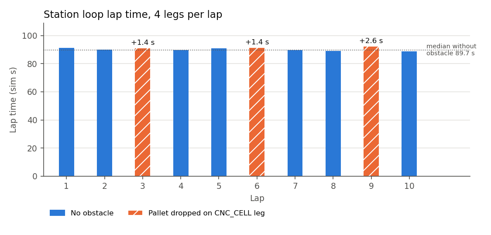
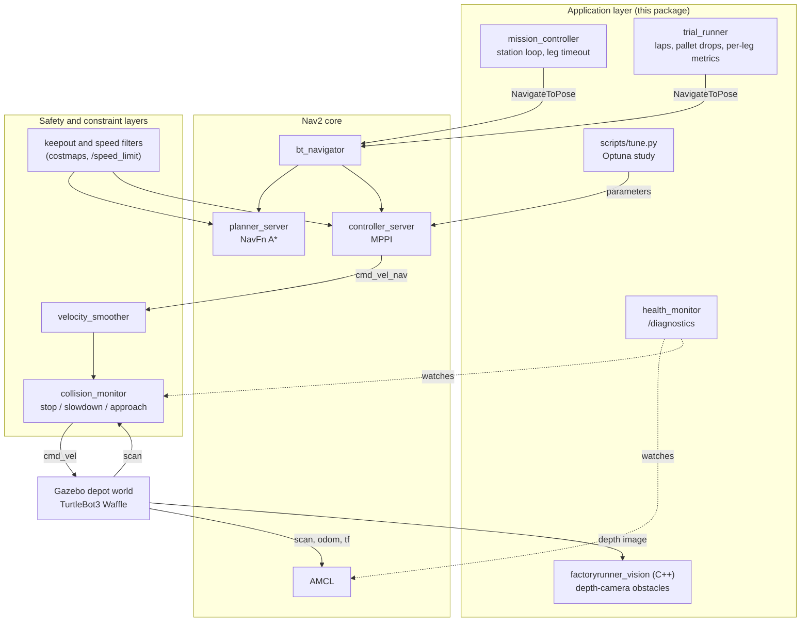
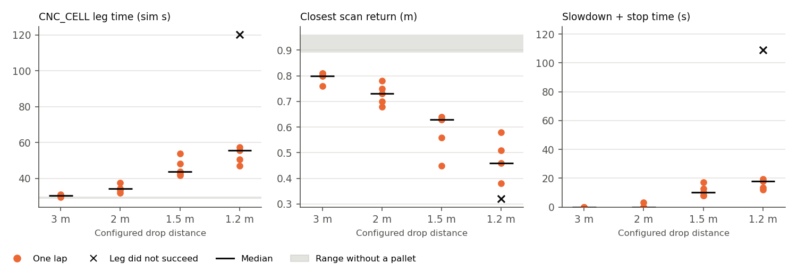
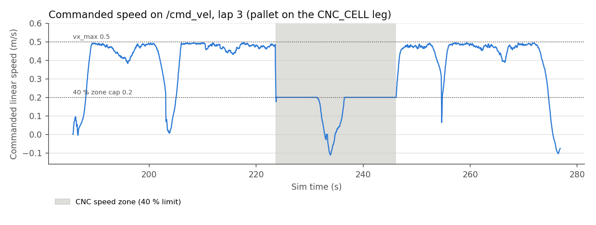
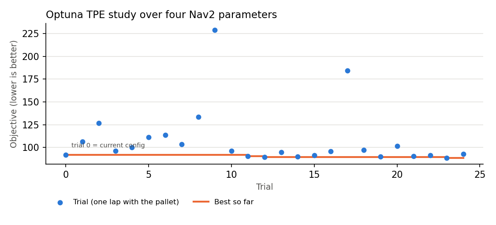

# FactoryRunner

A TurtleBot3 Waffle works a four-station loop in Gazebo's depot world under Nav2, from RAW_MATERIAL to CNC_CELL to INSPECTION and back to DOCK. A forklift lane is fenced off as a keepout zone, the CNC cell is a 40 % speed zone, and the collision monitor watches stop and slowdown fields around the robot. Navigation comes entirely from Nav2's plugins and configuration; on top of it sit a mission controller and a trial harness, and around it the tools used to put it under pressure: pallets dropped into its path at controlled distances or sliding across the aisle, a health monitor, a C++ depth-camera detector for obstacles the LiDAR cannot see, and a parameter study validated on laps it never saw. The robot is the stock model throughout.

**Video:** _link to be added_



## Highlights

- **Navigation that holds up under test.** All 40 legs of a 10-lap trial succeeded with a pallet dropped into the robot's path, and a sweep of drop distances shows where the safety layer takes over as warning time shrinks.
- **Two real faults traced to their cause.** A Nav2 freeze followed through gdb thread dumps into Fast DDS locks and fixed by changing middleware, and a 20 ms behaviour-tree timeout that let a single late reply abort an entire goal. The story is in [docs/CHALLENGES.md](docs/CHALLENGES.md).
- **Perception without touching the robot.** The Waffle's own depth camera, which Nav2's launch leaves unused, feeds a C++/OpenCV detector that spots a 10 cm crate the LiDAR never sees.
- **Machine learning where the data is.** An Optuna study of four Nav2 parameters; on a pallet position the study never used, the tuned set won 99 of 100 lap pairings against the defaults (10 laps each, p = 2.2 × 10⁻⁵), 3.8 % faster with no extra failures.
- **Reliability tooling.** A health monitor on `/diagnostics`, per-leg timeouts, a harness for static, timed and moving obstacles, local CI in `scripts/check.sh` and a headless Docker image.

## Quick start

On Ubuntu 24.04, native or under WSL2:

```bash
mkdir -p ~/fr_ws/src && cd ~/fr_ws/src
git clone https://github.com/not-good-keeper/factoryrunner-nav2.git
bash factoryrunner-nav2/scripts/setup_jazzy.sh        # ROS 2 Jazzy, Nav2, Gazebo, Cyclone DDS
cd ~/fr_ws && source /opt/ros/jazzy/setup.bash
colcon build --symlink-install --base-paths src src/factoryrunner-nav2/factoryrunner_vision
source install/setup.bash && export RMW_IMPLEMENTATION=rmw_cyclonedds_cpp
ros2 launch factoryrunner sim.launch.py               # terminal 1: Gazebo + RViz + Nav2
ros2 run factoryrunner mission_controller             # terminal 2 (same sourcing): one station loop
```

[Setup](#setup) and [Run](#run) cover the details and the other programs.

## Environment

| | Version |
|---|---|
| OS | Ubuntu 24.04.5 LTS (WSL2 on Windows 11, RTX 3060) |
| ROS 2 | Jazzy; `ros-jazzy-navigation2` 1.3.13 |
| Simulator | Gazebo Harmonic (gz sim 8.15.0), `ros-jazzy-ros-gz-sim` 1.0.24 |
| Robot and world | `nav2_minimal_tb3_sim` 1.0.1 (default `turtlebot3_waffle`), depot world from `nav2_minimal_tb4_sim` 1.0.1 |
| Middleware | Cyclone DDS (`rmw_cyclonedds_cpp` 2.2.4) |
| Tuner | Optuna 5.0.0 in a venv |
| Vision | C++17, OpenCV 4.6, `cv_bridge` 4.1 |

## How it fits together



The core is plain Nav2. AMCL localizes against Nav2's depot map, NavFn plans with A*, MPPI follows the path, and Jazzy's default replanning-and-recovery behaviour tree ties them together.

The safety and constraint layers are configuration on top of that core. Costmap filters read two masks generated from the depot map by `scripts/make_masks.py`: the keepout mask marks the forklift lane (map x 2.0 to 2.8 m, y −2.5 to 2.5 m) as lethal, and the speed mask sets a 40 % limit around the CNC cell, which the speed filter publishes on `/speed_limit` for MPPI to apply. The collision monitor sits between the velocity smoother and the robot, with a stop box, a slowdown box that cuts speed to 30 %, and Jazzy's footprint-approach check.

The application layer is this package. `mission_controller` sends the stations from `config/mission.yaml` one at a time, cancels any leg that runs past `leg_timeout_s` (120 simulated seconds by default) and logs every leg to `results/missions.csv`. `trial_runner` drives a set number of laps, drops a pallet onto the CNC_CELL leg on chosen laps and records per-leg metrics; `obstacle` spawns and removes the pallet; and `scripts/tune.py` runs the parameter study. `health_monitor` and the C++ `factoryrunner_vision` detector only watch, one the stack and the other the robot's depth camera, and never command motion.

## Setup

On a fresh Ubuntu 24.04 machine:

```bash
mkdir -p ~/fr_ws/src && cd ~/fr_ws/src
git clone https://github.com/not-good-keeper/factoryrunner-nav2.git
bash factoryrunner-nav2/scripts/setup_jazzy.sh
```

The script installs ROS 2 Jazzy, Nav2, the TurtleBot simulation packages and Cyclone DDS, adds the ROS environment and `RMW_IMPLEMENTATION=rmw_cyclonedds_cpp` to `~/.bashrc`, and creates `~/fr_venv` with Optuna for the tuner. Then build:

```bash
cd ~/fr_ws
source /opt/ros/jazzy/setup.bash
colcon build --symlink-install --base-paths src src/factoryrunner-nav2/factoryrunner_vision
source install/setup.bash
```

The C++ package `factoryrunner_vision` lives inside the Python package's folder, where colcon stops searching, which is why it appears as a second base path. The first launch downloads the depot model from Gazebo Fuel, so it needs an internet connection once.

For headless runs without a ROS installation, the Docker image builds the same two packages on `ros:jazzy-ros-base` and runs a single program against a headless simulation, writing its results to the mounted folder:

```bash
docker build -t factoryrunner .
docker run --rm -v "$PWD/results:/ws/src/factoryrunner-nav2/results" factoryrunner
docker run --rm -v "$PWD/results:/ws/src/factoryrunner-nav2/results" factoryrunner trial_runner
```

The image comes to 5.64 GB. A containerised mission completed all four legs in 92.5 s of simulated time and the container shut itself down 204 s after starting, Gazebo's first-launch model download included (`results/docker/missions.csv`). No GPU is passed in, so Gazebo's sensor rendering presumably falls back to the CPU inside the container.

## Run

Every terminal needs ROS, the workspace and Cyclone DDS:

```bash
source /opt/ros/jazzy/setup.bash && source ~/fr_ws/install/setup.bash && export RMW_IMPLEMENTATION=rmw_cyclonedds_cpp
```

```bash
# terminal 1: Gazebo, RViz and Nav2 in the depot world
ros2 launch factoryrunner sim.launch.py

# terminal 2, within about a minute of Nav2 coming up: one pass of the station loop
ros2 run factoryrunner mission_controller

# or the 10-lap trial with the pallet on laps 3, 6 and 9 (about 16 minutes)
ros2 run factoryrunner trial_runner

# drop the pallet anywhere by hand (map-frame metres), and take it away again
ros2 run factoryrunner obstacle spawn --x 7.71 --y -0.60
ros2 run factoryrunner obstacle remove

# stack health on /diagnostics, logged on every change
ros2 run factoryrunner health_monitor

# depth-camera obstacle detector (bridges the Waffle's own depth camera)
ros2 launch factoryrunner vision.launch.py

# one lap with the pallet dropped 1.5 m ahead, for recording
ros2 run factoryrunner trial_runner --ros-args -p mission_file:=$(ros2 pkg prefix --share factoryrunner)/config/video.yaml

# a pallet that crosses the aisle in front of the robot, 3 laps
ros2 run factoryrunner trial_runner --ros-args -p mission_file:=$(ros2 pkg prefix --share factoryrunner)/config/crossing.yaml

# the obstacle-distance sweep: 3 laps each at 3.0, 2.0, 1.5 and 1.2 m
bash ~/fr_ws/src/factoryrunner-nav2/scripts/obstacle_sweep.sh 3 3.0 2.0 1.5 1.2
```

Adding `headless:=True use_rviz:=False` to the launch runs it without windows. Results are written to `results/` in this checkout. Navigation only becomes active once the controller has set the initial pose, so the controller should start within about a minute of the launch, before the planner's activation times out.

`scripts/check.sh` runs the same lint, build and unit-test steps as `.github/workflows/ci.yml`, on a clean copy of the files git would commit. It stands in for CI, since GitHub Actions does not run on this account.

```bash
bash scripts/check.sh
```

## Configuration changes from Jazzy's defaults

`config/nav2_params.yaml` starts as a copy of `nav2_bringup/params/nav2_params.yaml`, and these are its only changes:

| Change | Reason |
|---|---|
| `planner_server.GridBased.use_astar: true` | A* instead of Dijkstra in NavFn, a one-line switch. The two were not benchmarked against each other, so no speed claim is made. |
| Keepout filter in both costmaps, ahead of `inflation_layer` | Marks the forklift lane lethal. Placed before inflation so the lane gets the same 0.7 m band as a wall; placed after it, paths hugged the lane's corner and MPPI got stuck there. |
| Speed filter in the global costmap, publishing `/speed_limit` | The 40 % limit in the CNC cell, applied by MPPI. |
| Collision monitor `StopZone` and `SlowdownZone` polygons | LiDAR safety fields ahead of the robot; the slowdown field cuts speed to 30 %. |
| `bt_navigator.default_server_timeout: 200` (default 20 ms) | A planner acknowledgement later than 20 ms failed the replanning step without an error code, so the default tree skipped its recoveries and aborted the goal. |
| Cyclone DDS instead of Fast DDS (an environment setting, not part of the file) | The Nav2 process froze in 2 of 3 runs under Fast DDS 2.14.7 on this machine and has not frozen since the switch. |

## Results

Every figure below comes from a file in `results/`. The runs are headless on the machine described above, and times are in simulated seconds.

**10-lap trial** (`results/trials_20261026-194747.csv`). The pallet, a 0.5 m cube, was dropped halfway along the RAW_MATERIAL → CNC_CELL leg on laps 3, 6 and 9, once the robot came within 3 m of its spot; in practice the drops happened 2.68 to 2.86 m away.

| | Laps | Lap time (s) | CNC_CELL leg (s) | Closest scan return on the CNC_CELL leg (m) |
|---|---|---|---|---|
| No pallet | 7 | 88.9–91.4, median 89.7 | 28.6–29.9 | 0.89–0.96 |
| Pallet | 3 | 91.1, 91.2, 92.3 | 30.0–31.1 | 0.78–0.81 |

All 40 legs succeeded with no recoveries, and the collision monitor never left its normal state. Three metres of warning is enough for the planner to route around the pallet before the slowdown field, which reaches 0.70 m ahead, comes into play. The pallet laps finished 1.4, 1.5 and 2.6 s above the median lap without one, and only the slowest falls outside the no-pallet range, by 0.9 s. The sweep below shows what happens with less warning.

**Obstacle-distance sweep** (`results/obstacle_sweep_20261026-213234/`, three laps per distance, and `results/obstacle_sweep_20261027-200023/`, two more; `scripts/obstacle_sweep.sh`). The same pallet at the same spot, dropped at four configured distances, five laps each:



| Configured drop | CNC_CELL leg (s) | Closest scan return (m) | Slowdown + stop (s) | Legs succeeded |
|---|---|---|---|---|
| 3.0 m | 29.7–31.2 | 0.76–0.81 | 0 | 5/5 |
| 2.0 m | 31.9–37.5 | 0.68–0.78 | 0–3.3 | 5/5 |
| 1.5 m | 41.7–53.9 | 0.45–0.64 | 8.1–17.1 | 5/5 |
| 1.2 m | 47.1–57.4, and one canceled at 120 s | 0.38–0.58, and 0.32 | 12.1–19.5, and 108.6 | 4/5 |

With three metres of warning the planner reroutes before the safety fields are involved at all. From two metres down, the slowdown field takes an ever larger share of the leg and the robot passes ever closer to the pallet. In one lap in five at the closest setting the pallet ended up inside the stop field, where the collision monitor blocks every command, including the reversing that would free the robot, so it stayed put until the 120 s leg timeout canceled the leg. The pallet also tends to appear a little later than configured, between 0.02 and 0.35 m closer (logged trigger distances of 2.66–2.98 m, 1.66–1.87 m, 1.15–1.44 m and 0.91–1.17 m), because the trigger reads AMCL's pose, which is only republished after 0.25 m of travel.

`config/video.yaml` uses the 1.5 m setting, where all five sweep laps succeeded with 8 to 17 s of visible slowdown. A separate single lap in that mode (`results/video_mode/`) triggered at 1.40 m and passed 0.73 m from the pallet without slowing, so a recording may need a second take.

**Moving obstacle** (`results/crossing/trials_20261026-215920.csv`, `config/crossing.yaml`). Here the pallet appears at the shelf edge beside the CNC_CELL path once the robot is 3 m away, then slides across the path to the open side of the aisle at 0.25 m/s, much like a cart crossing in front of the robot. The pallet is a static model moved in 0.0125 m steps at 20 Hz through Gazebo's `set_pose` service (`factoryrunner/crossing.py`); with the robot parked, its LiDAR return swung from −15° to +17° as it slid 1.2 m.

| Lap | CNC_CELL leg (s) | Path (m) | Recoveries | Closest scan return (m) | Slowdown (s) |
|---|---|---|---|---|---|
| 1 | 59.3 | 13.75 | 1 | 0.25 | 13.8 |
| 2 | 40.2 | 11.69 | 0 | 0.37 | 0.3 |
| 3 | 65.0 | 12.60 | 5 | 0.23 | 20.0 |

All twelve legs succeeded, but the crossing pallet is the hardest case here. The leg took 40 to 65 s against about 30 s with no obstacle, the path stretched to 11.7–13.8 m from 9.7–10.0 m, and the robot came within 0.23–0.37 m. Nav2's costmaps record each scan as static obstacles, so a moving one is chased by replanning rather than predicted. An earlier attempt at this run (`results/crossing/trials_20261026-212629.csv`) stopped after one leg because of a bug in the mover rather than in navigation, as the challenges log explains.

**Speed zone** (`results/speed_profile_trials_10lap_20261027b.csv`, exported from the trial's rosbag). Over the ten laps the robot entered the CNC zone 10 times and spent about 224 s inside it. Commanded speed on `/cmd_vel` had a median and 95th percentile of 0.200 m/s in the zone, exactly 40 % of MPPI's 0.5 m/s, against 0.472 and 0.493 m/s outside. Only 34 of 4,748 samples in the zone exceeded 0.21 m/s, all within 0.14 s of entry, while the velocity smoother was still braking at its 2.5 m/s² limit.



**Single missions** (`results/missions.csv`) hold every mission run while the faults described in the challenges log were being fixed, failures included, and that log maps each run ID to its configuration.

## Monitoring: health monitor

`health_monitor` checks the running stack once a second, publishes the result on `/diagnostics` and logs every change of level. It tracks four things: how long since `map → odom` last arrived on `/tf` (AMCL republishes it with every scan it processes), the `/scan` rate, the lifecycle state of AMCL, the map server, planner, controller, velocity smoother, collision monitor and behaviour-tree navigator, and the collision monitor's current action. A node that does not answer a lifecycle query counts as an error. The checks themselves are plain functions in `factoryrunner/health.py`, covered by unit tests.

To see whether it would catch a real fault, the process hosting all the Nav2 nodes was frozen with `SIGSTOP` for 10 s during a mission's first leg, then resumed (`results/freeze_test/`, default configuration):

| Time after the freeze | What the monitor reported |
|---|---|
| +1.3 s | WARN: `map → odom` 1.3 s old |
| +2.3 s | ERROR: no answer from any of the seven Nav2 nodes |
| +3.3 s | ERROR: `map → odom` 3.3 s old |
| +14.5 s (4.5 s after resuming) | back to OK, then the stop field active and two nodes inactive |
| +20.3 s to +22.3 s | WARN, then ERROR again: no answer from the nodes, `map → odom` stale |

The second failure is Nav2 doing what it was designed to do. When the process resumed, both of Nav2's lifecycle managers had gone more than 4 s without a bond heartbeat, so they declared their servers down and deactivated and cleaned up every node they manage; `bt_navigator` aborted the goal on the way down, and nothing restarts the stack after that. The mission controller's leg timeout then logged the dead leg as canceled after 120 s, and its cancel request gave up after 10 s rather than waiting forever. Any stall longer than about 4 s therefore takes navigation down until someone restarts it, and the monitor is what makes that visible within seconds instead of when the robot fails to arrive.

## Perception: what the LiDAR cannot see

The assignment's robot is the stock Waffle, so nothing was added to it. It already carries a RealSense depth camera in its Gazebo model (320 × 240, 60° field of view, 5 Hz), which Nav2's TurtleBot launch simply never bridges into ROS. `launch/vision.launch.py` bridges it and starts `factoryrunner_vision`, a C++ node built on OpenCV.

For each depth frame the node back-projects every pixel into 3D using the camera intrinsics from `camera_info` and the camera's mounting height of 0.226 m, measured from floor pixels in live frames. It keeps points between 3 cm and 1 m above the floor inside a corridor 0.35 m either side of the camera's axis, up to 4 m ahead, cleans that mask with a morphological opening and groups what is left into obstacles with connected components. It then publishes the nearest obstacle, RViz markers and an annotated debug image, and flags any obstacle whose top sits below the 2D LiDAR's scan plane at about 0.17 m, because the LiDAR cannot see those at all. The detection maths uses no ROS types and is covered by gtests on synthetic depth images. The node only observes; nothing it publishes reaches Nav2 or the velocity commands.

**Blind-spot test** (`results/blindspot/`). During leg 2, a 0.4 × 0.4 × 0.10 m crate was dropped on the planned path 3 m ahead of the robot with the detector running. The camera reported it when the robot was 2.83 m away, flagged as lying below the LiDAR plane with its top 0.09 m above the floor, and kept reporting it as the robot closed in. Meanwhile the closest LiDAR return in the robot's forward ±20° stayed at 2.47 m while the crate was 0.5 to 2.5 m ahead, an echo from something behind it. Nav2, whose costmaps are fed only by the LiDAR, drove straight into the crate, bringing the robot's centre within 0.12 m of the crate's. The leg failed after 62.6 s, when the planner could no longer plan from the robot's estimated pose of roughly (13.1, 0.4), past the station; wheel slip on the crate most likely threw off odometry and localization, although that was not confirmed.

This is exactly the case the detector exists for. Feeding its detections into the local costmap would let Nav2 avoid such obstacles, but it would also change the navigation configuration that every other result here was measured with, so it is left as the next step.

## Machine learning: tuning Nav2 parameters against the harness

The default Waffle has no RGB camera, and the assignment's robot is the default one, so there was no image model to train. Learning went where the robot already produces data instead, as Bayesian optimisation of four Nav2 parameters scored by the trial harness. Nav2 still plans and controls; the tuner only changes parameter values at runtime and never touches the velocity commands.

| Parameter | Node | Range | Default |
|---|---|---|---|
| `FollowPath.vx_max` | controller_server | 0.30–0.50 | 0.5 |
| `FollowPath.PathFollowCritic.cost_weight` | controller_server | 2.0–10.0 | 5.0 |
| `FollowPath.CostCritic.cost_weight` | controller_server | 2.0–8.0 | 3.81 |
| `inflation_layer.cost_scaling_factor` | local_costmap | 2.0–6.0 | 3.0 |

Each trial sets the four values, drives one lap with the pallet at the tuning spot and scores it, lower being better. The weights were fixed before the study ran:

`lap_time_s + 60 × failed_legs + 10 × recoveries + 20 × max(0, 0.25 − min_clearance_m) / 0.25 + 5 × stop_events`

The study used Optuna's TPE sampler with seed 42, and its first trial was the default configuration. Its SQLite database (`results/tuning.db`) stays out of git, and `scripts/tune.py report` exports every trial to `results/tuning_study.csv`. Validation alternated default and best parameters lap by lap, with the pallet at a spot the study never used, 6.7 m instead of 4.7 m along the CNC_CELL leg.

**Study** (`results/tuning_study.csv`, `results/tuning_trials_20261026-201255.csv`). The default configuration scored 92.0 as trial 0. The best of 25 trials, trial 23, scored 88.7 with `vx_max` at 0.484, a PathFollow weight of 8.99, a Cost weight of 6.13 and a `cost_scaling_factor` of 3.60. Two samples did far worse, trials 9 and 17 with CNC_CELL legs of 95 s and 74 s, which is the sampler exploring. Trial 16 ran without its pallet after a spawn timeout, so its score is not comparable; it was not the best and is covered in the challenges log.



**Validation** (`results/validation_20261026-210504.csv` and `results/validation_20261027-194142.csv`, two runs of five laps a side on different days, with the same parameters and pallet spot):

| Parameters | Laps | Lap time (s) | Median (s) | CNC_CELL leg (s) | Failed legs | Recoveries | Closest scan return (m) |
|---|---|---|---|---|---|---|---|
| Default | 10 | 93.3, 95.8, 93.3, 96.3, 92.7, 93.3, 93.5, 93.8, 95.0, 96.1 | 93.6 | 30.9–35.0 | 0 | 0 | 0.63 |
| Tuned (trial 23) | 10 | 90.0, 89.7, 90.3, 92.3, 90.0, 90.2, 90.0, 89.7, 90.7, 93.0 | 90.1 | 30.5–33.1 | 0 | 0 | 0.63 |

Across the 100 possible pairings of a default lap with a tuned lap, the tuned lap was faster in 99; the one exception is the slowest tuned lap, at 93.0 s, against the fastest default, at 92.7 s. An exact two-sided Mann–Whitney test on the lap times gives p = 2.2 × 10⁻⁵, computed by `mann_whitney_exact` in `factoryrunner/tuning.py` and printed by `scripts/tune.py report`. The median lap fell by 3.5 s (3.8 %) with no change in failures, recoveries or the closest scan return, and the second run, on a later day, repeated what the first had shown on its own (p = 0.008 for its five laps a side). The tuned set has a slightly lower `vx_max` than the default, so the gain does not come from a higher speed cap. Heavier path-following and obstacle-cost weights producing fewer corrections would account for it, though that explanation has not been tested.

The conditions are still narrow: one machine, one held-out pallet spot, ten laps a side, and a spread of 3.6 s between the fastest and slowest default laps. The result says the tuned set was faster on this course in this simulation, not that it is better in general. The tuned values are not written into `config/nav2_params.yaml`, and every other result in this README uses the defaults.

## Path to hardware

Nothing in this project has run on a physical robot, so this section is a plan. On a real TurtleBot3 Waffle the depot map would give way to a map built on site with slam_toolbox, with the zone masks regenerated from it by `scripts/make_masks.py`. A real LDS-01 or LDS-02 LiDAR is noisier than the simulated one and struggles with glass and dark surfaces, so AMCL's laser model (`z_hit`, `sigma_hit`, `laser_max_range`) would need retuning against recorded scans before the station poses could be trusted. Wheel slip and uneven floors also break the simulator's near-perfect odometry, which means checking AMCL's motion-noise parameters `alpha1` to `alpha5` against logged runs and probably loosening the 0.25 m goal tolerance or adding a final alignment step at each station.

Safety needs a different footing. The collision monitor is a software layer, not a safety function, so a real cell needs a hardware emergency stop and, wherever people share the space, a safety-rated scanner, with the collision monitor kept as a second layer that slows the robot before the certified one has to stop it.

The depth detector would need a units fix before it ran on a real camera. A physical RealSense publishes depth as 16-bit millimetres (`16UC1`) rather than the simulator's 32-bit float metres, and `cv_bridge` converts the type without converting the units, so the node would need an explicit millimetre-to-metre step. Its mounting height would have to be measured again on the real robot by the same floor-pixel method, and the holes real depth has on shiny or dark surfaces are already skipped as invalid pixels.

The Fast DDS freeze is a reminder that the middleware itself can fail, which argues for running `health_monitor` from the first day on hardware, logging `/diagnostics` with every run and treating a silent node as a fault rather than a slow one. The leg timeout already turns a hung goal into a logged failure instead of a robot waiting forever. Most of the test tooling would carry over as it is: the trial harness sends goals and records topics, so the same laps, metrics and CSV files would work on a real robot with a person placing the pallet, and the speed-zone and collision-monitor checks read the same topics.

## Known limitations

Everything here is simulation, and the collision monitor is not a certified safety function, with fields sized for this robot in simulation. Localization depends on Nav2's depot map, so the robot has to start at its spawn point, map (0, 0), and the station poses were picked by hand from that map. The samples are small (a 10-lap trial, 25 study trials, ten validation laps a side, three to five laps per sweep distance), so differences of a second or two sit within run-to-run spread, and the Fast DDS freeze was seen on one machine over a handful of runs, which makes the diagnosis strong evidence rather than a reproduced bug report.

Several limits come from the navigation stack itself. Obstacles below the LiDAR plane are invisible to navigation: the depth detector sees them but only reports, and Nav2 drove into a 10 cm crate in the blind-spot test. An obstacle that ends up inside the stop field can hold the robot still indefinitely, because the collision monitor also blocks the motions that would free it, and the leg timeout turns that into a logged failure, not a recovery. Any stall longer than Nav2's 4 s bond timeout leaves the stack down until it is restarted; the health monitor reports it, but nothing restarts it. And moving obstacles are handled by replanning around each new scan rather than by predicting their motion, which is why the crossing-pallet legs took 40 to 65 s instead of about 30 s.

## Biggest challenge

The robot would finish its first leg and then stop for good, with the `map` frame gone. AMCL looked like the culprit, but it had not crashed: every Nav2 node had dropped off the ROS graph while the process hosting them was still alive. The debugger could not attach to a running process on this system, so the Nav2 process was started under gdb through `ros2 launch --launch-prefix`, and at the next freeze a dump of all its threads showed twenty of them blocked on Fast DDS locks and none in Nav2's own code. Moving to Cyclone DDS ended the freeze. The same runs revealed a second, unrelated fault, in which Jazzy's 20 ms `default_server_timeout` let one late planner reply abort a whole goal, because the default behaviour tree only runs its recoveries for specific error codes. The full account, with every run counted, is in [docs/CHALLENGES.md](docs/CHALLENGES.md).
